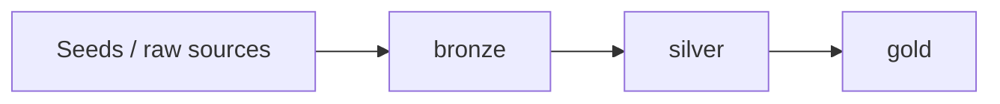

# my_dbt_project

A dbt project on **Databricks** that transforms raw e-commerce sales data into analytics-ready tables using a **medallion (bronze / silver / gold)** architecture, with automated testing and CI/CD to production.

> Built as a hands-on project to learn the modern dbt workflow end to end.

## Tech stack

| Area | Tools |
|---|---|
| Transformation | dbt-core, dbt-databricks, SQL, Jinja, Jinja SQL, macros |
| Warehouse | Databricks |
| Environment | Python 3.12, [uv](https://docs.astral.sh/uv/) |
| Dev tooling | VS Code + dbt Power User, terminal / dbt CLI |
| CI/CD | GitHub Actions |

## Architecture



| Layer | Schema | Materialization | Purpose |
|---|---|---|---|
| Bronze | `bronze` | table, view | raw data as loaded, minimal changes |
| Silver | `silver` | table | cleaned, typed, deduplicated, aggregated |
| Gold | `gold` | table | business-level marts with SCD1 |

## Project structure

```
├── models/
│   ├── bronze/
│   ├── silver/
│   └── gold/
├── macros/       # reusable Jinja macros: generate_schema, multiplier
├── seeds/        # mapping table
├── snapshots/
├── analyses/
├── tests/        # custom and generic data tests
└── dbt_project.yml
```

## Highlights

- **Medallion architecture** with each layer in its own schema, configured centrally in `dbt_project.yml`.
- **Jinja macros** for schema generation, column multiplication.
- **Data tests** for uniqueness, not-null, custom tests for non-negative sales values.
- **CI/CD**: on pull request: build and test; on merge to main: deploy to prod.
- **Production deployment** on Databricks.

## Getting started

**Prerequisites:** Python 3.12+, [uv](https://docs.astral.sh/uv/), a Databricks workspace with a SQL warehouse.

```bash
git clone https://github.com/Alina412/dbt-project.git
cd dbt-project
uv sync
```

Add a profile named `my_dbt_project` to `~/.dbt/profiles.yml` (example; adjust to your workspace):

```yaml
my_dbt_project:
  target: dev
  outputs:
    dev:
      type: databricks
      host: <workspace-host>
      http_path: <sql-warehouse-http-path>
      token: "{{ env_var('DATABRICKS_TOKEN') }}"
      catalog: <catalog>
      schema: dev
      threads: 4
```

Run the project:

```bash
uv run dbt debug     # check the connection
uv run dbt seed      # load seed data into bronze
uv run dbt run       # build all models
uv run dbt test      # run data tests
```

## Resources

- [dbt documentation](https://docs.getdbt.com/docs/introduction)
- [dbt-databricks adapter](https://docs.getdbt.com/docs/core/connect-data-platform/databricks-setup)
